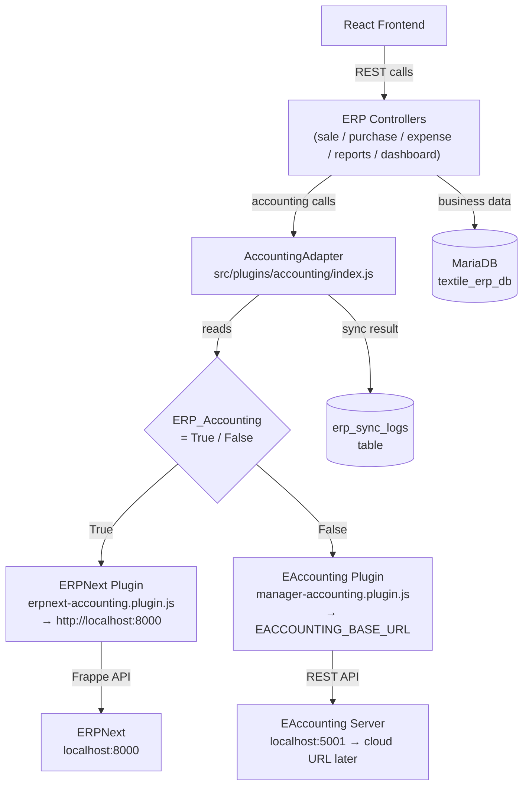
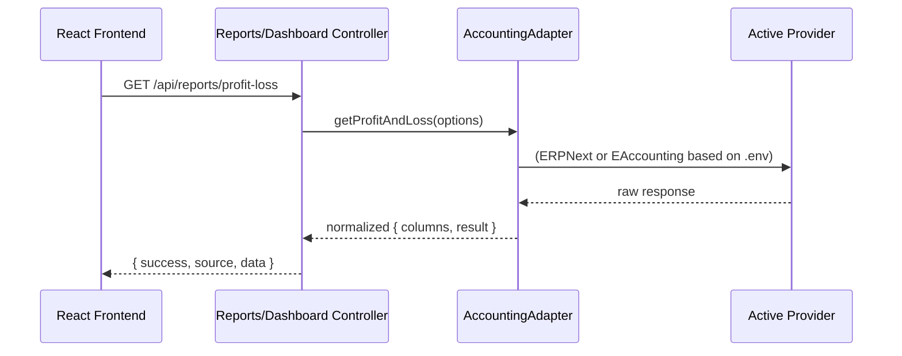
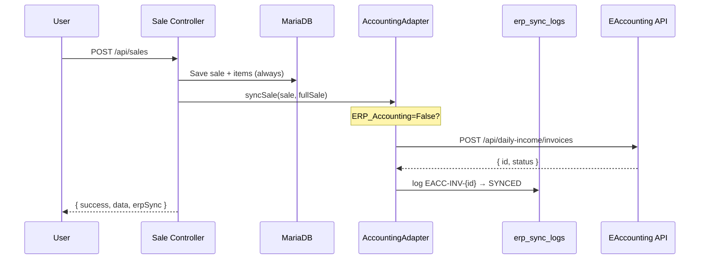
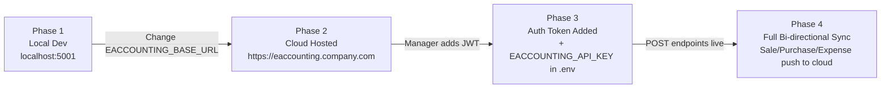

# Accounting Plugin Integration — Implementation Plan

> **Project:** Clothing & Textiles Shop ERP  
> **Goal:** Plug in EAccounting module as a switchable alternative to ERPNext — controlled by one `.env` variable.  
> **Constraint:** Zero changes to existing business logic, DB schema, or frontend.

---

## The Switch

```
backend/.env

  ERP_Accounting=True   →  All accounting via ERPNext (port 8000)   ← default, existing behavior
  ERP_Accounting=False  →  All accounting via EAccounting (port 5001 / cloud URL)
```

No code change needed to switch. No server restart in dev. Frontend never knows.

---

## Architecture



---

## Plugin File Structure

```
backend/src/plugins/
├── plugin.manifest.json                   ← plugin descriptor (name, version, routes)
└── accounting/
    ├── index.js                           ← AccountingAdapter — the main switch
    ├── erpnext-accounting.plugin.js       ← thin wrapper around ErpReportsService
    ├── manager-accounting.plugin.js       ← axios client for EAccounting REST API
    └── route.js                           ← /api/plugins/accounting/* health & manifest endpoints
```

> [!IMPORTANT]
> These 4 files are the **only new code**. Everything else is a small, targeted edit to existing files.

---

## Data & Sync Flow

### Reports / Dashboard (READ)



Both providers return **identical JSON shapes** — frontend code is unchanged.

### Sale / Purchase / Expense (WRITE + SYNC)



> [!NOTE]
> Sync is **fire-and-forget** — if EAccounting is unreachable, the sale still saves successfully in MariaDB. The sync failure is logged but does not block the user.

---

## What EAccounting Receives (Data Contract)

### Sale Sync Payload → `POST /api/daily-income/invoices`
```json
{
  "external_id": "SALE-42",
  "tenant_id": "tenant-demo-01",
  "customer_name": "John Doe",
  "invoice_date": "2026-11-17",
  "due_date": "2026-11-17",
  "payment_method": "CASH",
  "payment_status": "PAID",
  "items": [
    { "description": "Cotton Shirt L Blue", "qty": 2, "rate": 450.00, "amount": 900.00 }
  ],
  "subtotal": 900.00,
  "discount": 50.00,
  "grand_total": 850.00,
  "paid_amount": 850.00
}
```

### Purchase Sync → `POST /api/purchase-management/bills`
```json
{
  "external_id": "PUR-18",
  "tenant_id": "tenant-demo-01",
  "supplier_name": "Textile Supplier Co.",
  "bill_date": "2026-11-17",
  "items": [...],
  "grand_total": 12500.00,
  "paid_amount": 12500.00,
  "payment_method": "BANK"
}
```

### Expense Sync → `POST /api/daily-expenses/entries`
```json
{
  "external_id": "EXP-9",
  "tenant_id": "tenant-demo-01",
  "title": "Electricity Bill",
  "category": "Utilities",
  "amount": 3200.00,
  "expense_date": "2026-11-17",
  "payment_method": "BANK"
}
```

> [!WARNING]
> EAccounting currently only has **GET endpoints**. The `POST` sync endpoints above need to be built by your manager's team. Until then, sync calls are logged but no-op. **Reports and Dashboard work immediately.**

---

## API Mapping Table

| Function | ERPNext endpoint | EAccounting endpoint |
|---|---|---|
| Profit & Loss | `POST /api/method/frappe.desk.query_report.run` → `Profit and Loss Statement` | `GET /api/profit-loss/summary` |
| Balance Sheet | Same → `Balance Sheet` | `GET /api/balance-sheet/summary` |
| Trial Balance | Same → `Trial Balance` | `GET /api/reports/trial-balance` |
| General Ledger | Same → `General Ledger` | `GET /api/reports/day-book` |
| Accounts Receivable | Same → `Accounts Receivable` | `GET /api/outstanding/customers` |
| Accounts Payable | Same → `Accounts Payable` | `GET /api/outstanding/suppliers` |
| Stock Balance | Same → `Stock Balance` | *(not available — returns empty)* |
| Dashboard Metrics | GL account balance queries | `GET /api/cash-bank/summary` + `GET /api/profit-loss/summary` |
| Sync Sale | `POST Sales Invoice` → ERPNext | `POST /api/daily-income/invoices` → EAccounting |
| Sync Purchase | `POST Purchase Invoice` → ERPNext | `POST /api/purchase-management/bills` → EAccounting |
| Sync Expense | `POST Journal Entry` → ERPNext | `POST /api/daily-expenses/entries` → EAccounting |

---

## Required Headers (Every EAccounting API Call)

```
x-tenant-id:    tenant-demo-01       ← from EACCOUNTING_TENANT_ID in .env
x-host-app-id:  textile-erp          ← from EACCOUNTING_HOST_APP_ID in .env
x-user-id:      (logged-in user id)  ← passed per-request
x-role:         admin                ← default role
```

---

## .env Changes Required

```bash
# --- Accounting Plugin Switch ---
ERP_Accounting=True              # True = ERPNext | False = EAccounting

# --- EAccounting Module Config ---
EACCOUNTING_BASE_URL=http://localhost:5001     # ← change to cloud URL when deployed
EACCOUNTING_TENANT_ID=tenant-demo-01
EACCOUNTING_HOST_APP_ID=textile-erp
EACCOUNTING_TIMEOUT=10000
```

**Cloud migration = change `EACCOUNTING_BASE_URL` only. Nothing else.**

---

## Files to Create / Modify

### 🆕 New Files (Plugin — isolated, no existing code touched)

| File | Purpose |
|---|---|
| `src/plugins/accounting/index.js` | `AccountingAdapter` class — reads env, delegates to correct provider |
| `src/plugins/accounting/erpnext-accounting.plugin.js` | Wraps existing `ErpReportsService` |
| `src/plugins/accounting/manager-accounting.plugin.js` | axios HTTP client for EAccounting API |
| `src/plugins/accounting/route.js` | Plugin health & manifest API routes |
| `src/plugins/plugin.manifest.json` | Plugin descriptor JSON |

### ✏️ Existing Files — Small Targeted Edits Only

| File | Change |
|---|---|
| `backend/.env` | Add 5 new env keys |
| `src/config/env.js` | Parse `ERP_Accounting` + `EACCOUNTING_*` keys |
| `src/actions/reports/controller.js` | Swap `ErpReportsService.*` → `AccountingAdapter.*` |
| `src/actions/dashboard/controller.js` | Swap `ErpReportsService.getDashboardMetrics()` → `AccountingAdapter.getDashboardFinancialMetrics()` |
| `src/actions/sale/controller.js` | Add `if (!isErpAccounting)` branch for EAccounting sync |
| `src/actions/purchase/controller.js` | Same branch pattern |
| `src/actions/expense/controller.js` | Same branch pattern |
| `src/actions/index.js` | Register plugin route under `/api/plugins/accounting` |

> [!NOTE]
> Existing `ErpReportsService`, all models, all DB logic, all inventory/pricing code — **completely untouched**.

---

## Plugin API Endpoints (New)

| Method | Route | Purpose |
|---|---|---|
| `GET` | `/api/plugins/accounting/status` | Health ping of both ERPNext and EAccounting |
| `GET` | `/api/plugins/accounting/manifest` | Returns plugin.manifest.json |
| `GET` | `/api/plugins/accounting/manager-modules` | Lists EAccounting's available modules |

---

## Cloud Migration Path (Future)



| Phase | What Changes | Your ERP Code Changes |
|---|---|---|
| Phase 1 → 2 (cloud URL) | `EACCOUNTING_BASE_URL` in `.env` | **None** |
| Phase 2 → 3 (add auth) | `EACCOUNTING_API_KEY` in `.env` + 1 line in plugin | **1 line in plugin file** |
| Phase 3 → 4 (write endpoints) | Manager deploys POST routes | **Plugin already calls them — just activate** |

---

## Testing Checklist

### ERPNext Mode (`ERP_Accounting=True`)
- [ ] `GET /api/reports/profit-loss` returns ERPNext data with `source: "ERPNext Accounting Module"`
- [ ] `GET /api/dashboard` returns ERPNext cash/bank balances
- [ ] `POST /api/sales` syncs invoice to ERPNext (`erp_sync_logs` has `Sales Invoice` entry)
- [ ] `GET /api/plugins/accounting/status` shows ERPNext: online

### EAccounting Mode (`ERP_Accounting=False`)
- [ ] `GET /api/reports/profit-loss` returns EAccounting data with `source: "EAccounting Module"`
- [ ] `GET /api/dashboard` returns EAccounting cash/bank summary
- [ ] `POST /api/sales` logs `EACC-INV-*` entry in `erp_sync_logs`
- [ ] `GET /api/plugins/accounting/status` shows EAccounting: online
- [ ] Switching `.env` and restarting flips provider correctly

---

## Summary

| Concern | Answer |
|---|---|
| Will existing features break? | No — business logic is untouched |
| Does frontend need changes? | No — same API shape returned |
| Does DB schema change? | No — only `.env` and new plugin files |
| Will cloud hosting break it? | No — change 1 env var |
| What if EAccounting is down? | Sale/purchase/expense still save in MariaDB; sync error is logged |
| How to switch providers? | Edit `ERP_Accounting=True/False` in `.env`, restart |
